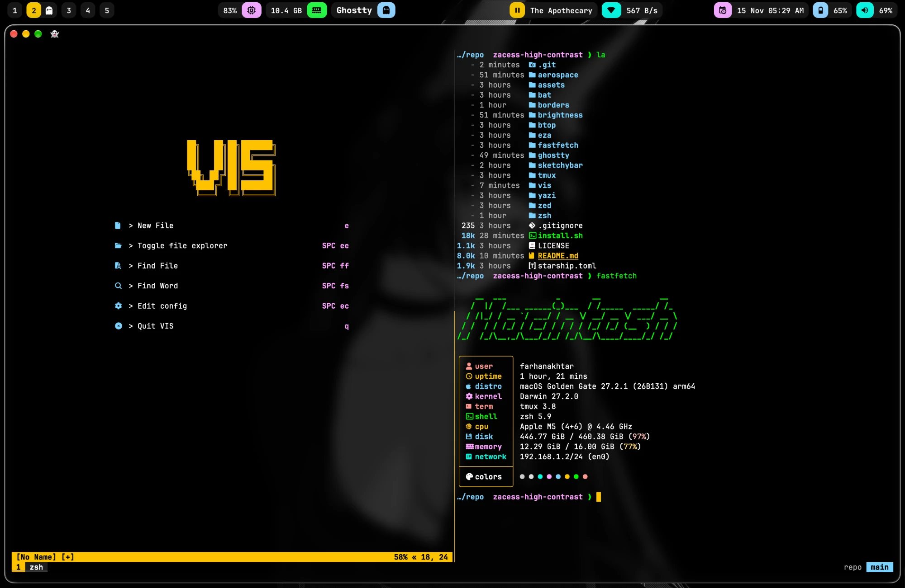

# macOS Dotfiles

A clean, modern, and reproducible macOS dotfiles setup featuring **AeroSpace** (tiling window manager), **SketchyBar** (status bar), **Ghostty** (GPU-accelerated terminal), **Tmux** (terminal multiplexer), **Starship** (cross-shell prompt), and **Fastfetch** — all unified with the **[Zacess High Contrast Dark](https://terminalthemes.com/themes/zacess-high-contrast-dark)** palette (pure black, bright accents) and XDG directory standards. Simple, fast, functional.



> [!NOTE]
> SketchyBar is a **sticky, translucent** full-width bar (38pt: taller than the 13" MacBook Air's
> 37.5pt notch strip, so it hides the notch). On other displays, adjust `height` and `notch_width`
> in `sketchybar/sketchybarrc`.

---

## Features & Components

- **Window Manager**: [AeroSpace](https://github.com/nikitabobko/AeroSpace) — i3-like tiling window manager for macOS with borders.
- **Status Bar**: [SketchyBar](https://github.com/FelixKratz/SketchyBar) — Highly customizable macOS status bar with workspaces, media, resource monitors, and smooth animations.
- **Terminal**: [Ghostty](https://ghostty.org/) — Ultra-fast, native GPU-accelerated terminal.
- **Multiplexer**: [Tmux](https://github.com/tmux/tmux) + [TPM](https://github.com/tmux-plugins/tpm) — Seamless navigation and a native (plugin-free) high-contrast status line.
- **Shell**: [Zsh](https://www.zsh.org/) + [Starship](https://starship.rs/) — no framework (Oh My Zsh removed), ~50ms startup, cached tool init, autosuggestions + syntax highlighting from Homebrew.
- **Fetch Utility**: [Fastfetch](https://github.com/fastfetch-cli/fastfetch) — Instant system overview with custom ASCII art.

---

## What Gets Installed & Symlinked

Every configuration is symlinked from this repository to `~/.config/` so changes in the repo stay live immediately.

| Component | Repo Path | Target Symlink | Purpose |
|---|---|---|---|
| **AeroSpace** | `aerospace/aerospace.toml` | `~/.config/aerospace/aerospace.toml` | Tiling window management rules, gaps, and keybindings |
| **Fastfetch** | `fastfetch/` | `~/.config/fastfetch/` | ASCII art logo & system information layout |
| **Ghostty** | `ghostty/config.ghostty` | `~/.config/ghostty/config.ghostty` | Font, inline Zacess palette, window styles |
| **SketchyBar** | `sketchybar/` | `~/.config/sketchybar/` | Status bar geometry, items, and shell plugin scripts |
| **Starship** | `starship.toml` | `~/.config/starship.toml` | Multi-module prompt theme and palette |
| **Tmux** | `tmux/tmux.conf` | `~/.config/tmux/tmux.conf` | Tmux prefix (`Ctrl+a`), window splits, vim-tmux-navigator |
| **Zsh** | `zsh/*` | `~/.config/zsh/*` | `.zshrc`, `.zprofile`, aliases, and integrations |
| **App themes** | `eza/`, `bat/`, `btop/`, `yazi/`, `zed/`, `vis/` | matching paths in `~/.config/` | Zacess theme files for each tool |
| **Zsh Env** | *(generated)* | `~/.zshenv` | Sets `export ZDOTDIR="$HOME/.config/zsh"` (single root exception) |

---

## Prerequisites

- **macOS** (Apple Silicon or Intel)
- **Homebrew** (the installer will automatically install Homebrew if missing)

---

## One-Line Installation

Clone the repository and run the automated installer:

```bash
git clone https://github.com/farhanakhtar0x66/dotfiles.git ~/Coding/Dotfiles && cd ~/Coding/Dotfiles && ./install.sh
```

### What `install.sh` Does

1. **Safety First**: Verifies macOS environment and backs up existing configs to `~/.dotfiles-backup/<timestamp>/`.
2. **Package Installation**: Installs required formulae and casks via Homebrew (SketchyBar, JankyBorders, AeroSpace, Ghostty, Starship, Fastfetch, Tmux, JetBrains Mono Nerd Font, etc.).
3. **Symlinking**: Creates symlinks to `~/.config/` with zero copying.
4. **Plugin Management**: Bootstraps TPM (Tmux Plugin Manager) and installs all defined Tmux plugins.
5. **Permissions**: Ensures all executable shell scripts receive proper permissions (`chmod +x`).
6. **Idempotency**: Safe to run repeatedly — skips already-satisfied packages, links, and configs.

---

## Customization

### Palette
| Role | Hex | | Role | Hex |
|---|---|---|---|---|
| background | `#000000` | | red | `#ff9e94` |
| foreground | `#ffffff` | | green | `#26f444` |
| accent / cursor | `#f5c400` | | blue | `#8fd0ff` |
| selection | `#0a2552` | | magenta | `#f2a6ff` |
| muted | `#b3b3b3` | | cyan | `#00f4e0` |

### SketchyBar
`sketchybar/colors.sh` holds the palette, fonts and animation speed; `sketchybarrc` the bar geometry. Items: workspaces (1–5 always shown, 6–9 appear only while focused or in use; real app icons from sketchybar-app-font), front app, media (`media-control`, click = play/pause), CPU/RAM, network, volume (scroll), battery, clock. Hovering any pill lightens it.
Reload with `sketchybar --reload`. CPU + RAM come from one ~4ms C helper (`helpers/sysstat.c`, built by `install.sh`). Workspace switches repaint from a cache and never wait on a window query; icons refresh separately (debounced, coalesced). Media is event-driven (`helpers/media_stream.sh` listens to `media-control stream`), so nothing polls.

### Brightness (`alt-shift-b`)
`brightness/rawmax.c` — `rawmax [toggle|max|indoor|status]`. *max*: 100% + linear gamma table; *indoor*: standard color profile + 55%. `install.sh` compiles it to `~/.local/bin/rawmax`.

### Window borders
`borders/bordersrc` — a light-grey outline on the focused window, none on others. Edit and run `borders`.

### Zsh
Profile startup any time with `ZPROF=1 zsh -i -c exit`. `ll` skips git status for speed; use `llg` when you want it.
tmux auto-starts only in Ghostty (not in Zed/VS Code terminals); each new tmux pane greets you with fastfetch.

### Editor: vis
Starting `vis` with no file shows a welcome page (a port of the old Neovim dashboard: block-letter banner + menu, `vis/welcome.lua`). `e` starts a new file, `␣ff`/`␣fs`/`␣ee`/`␣ec` find files, search, browse or edit the config, `q` quits; it disappears as soon as you open or type anything. `vis/visrc.lua` mirrors the old Neovim keys (leader = Space): `jk` escape, `␣w` save, `␣sv`/`␣sh`/`␣sx` splits, `␣ff` find file (fzf), `␣fs` grep (ripgrep+fzf), `␣ee` explorer (yazi), `␣lg` lazygit, `␣y`/`␣p` system clipboard. Run it as `vis`, `vim` or `vi`. Homebrew's vis bottle is broken (Lua 5.5 core + Lua 5.1 lpeg), so `install.sh` builds vis 0.9 and lpeg against Lua 5.4 into `~/.local`.

### Apps configured in place (not symlinked)
These files also hold your own settings, so the installer doesn't manage them. They now point at the Zacess theme:
- Zed `settings.json`: `"theme": "Zacess High Contrast Dark"`
- btop `btop.conf`: `color_theme = "zacess"`
- opencode `cli.json`: theme `system` (follows the terminal palette)

### AeroSpace Keybindings & Gaps
Customize your workspaces, modifiers, and application bindings in `aerospace/aerospace.toml`. Reload with:
```bash
aerospace reload-config
```

---

## Uninstallation

To remove all created symlinks and automatically restore your previous configuration backup:

```bash
./install.sh --uninstall
```

---

## Credits & Acknowledgements

- **Theme**: [Zacess High Contrast Dark](https://terminalthemes.com/themes/zacess-high-contrast-dark)
- **App icons**: [sketchybar-app-font](https://github.com/kvndrsslr/sketchybar-app-font)
- **Window Management**: [AeroSpace](https://github.com/nikitabobko/AeroSpace) by Nikita Bobko
- **Status Bar & Borders**: [SketchyBar](https://github.com/FelixKratz/SketchyBar) & [JankyBorders](https://github.com/FelixKratz/JankyBorders) by Felix Kratz
- **Terminal**: [Ghostty](https://ghostty.org/) by Mitchell Hashimoto
- **Prompt**: [Starship](https://starship.rs/)
- **System Info**: [Fastfetch](https://github.com/fastfetch-cli/fastfetch)
- **Tmux Plugins**: [TPM](https://github.com/tmux-plugins/tpm), [vim-tmux-navigator](https://github.com/christoomey/vim-tmux-navigator)

---

## License

Distributed under the [MIT License](LICENSE).
